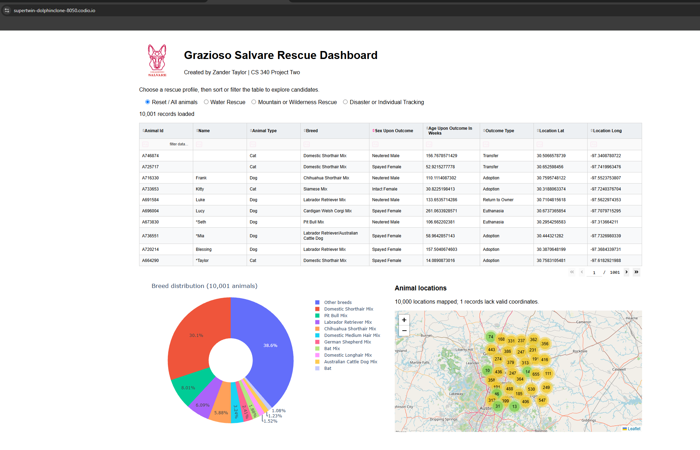
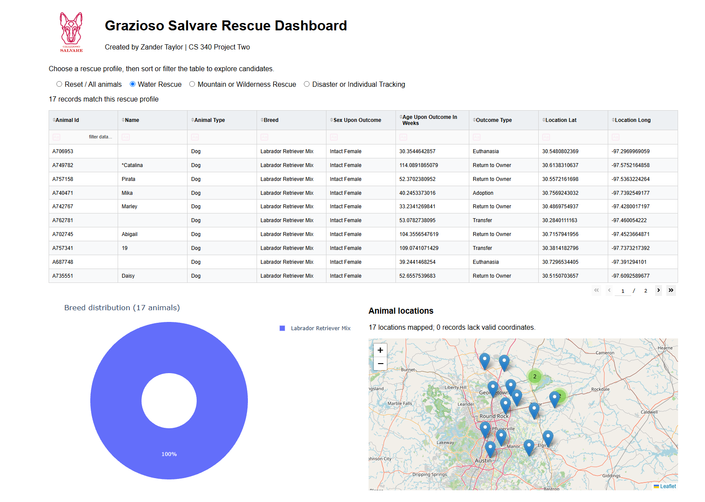
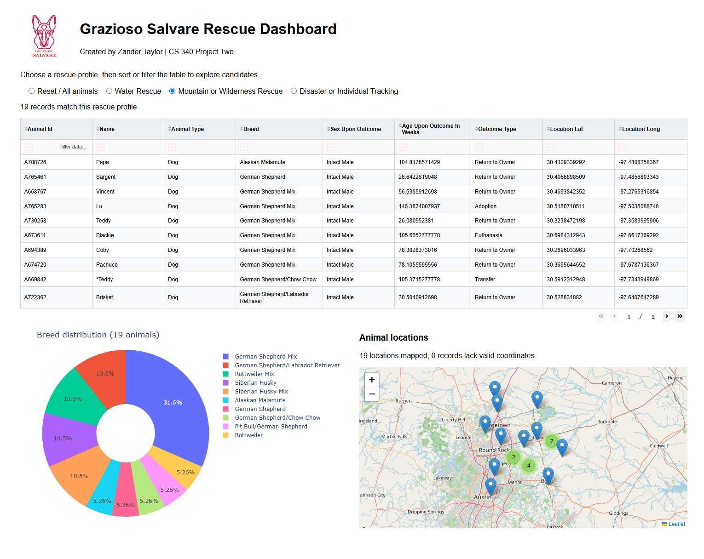
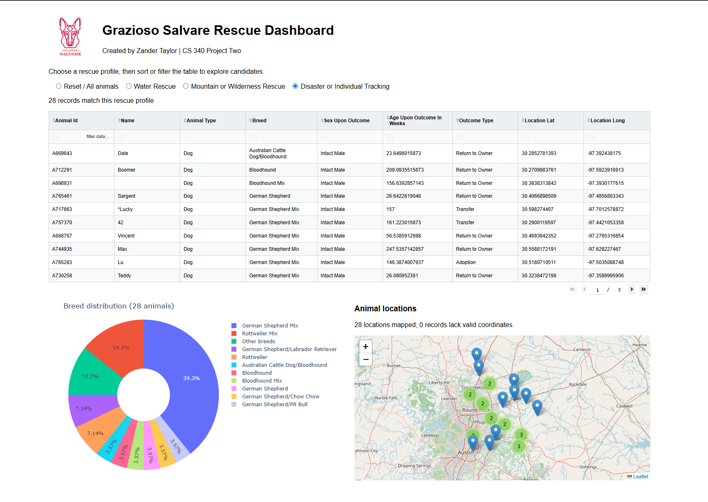
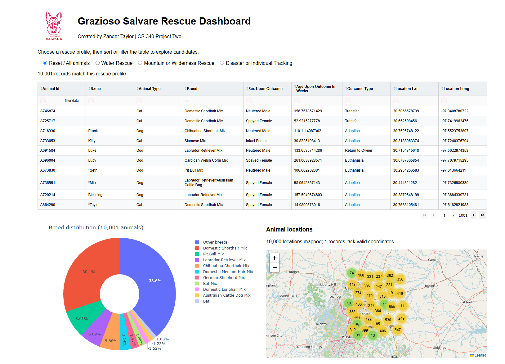
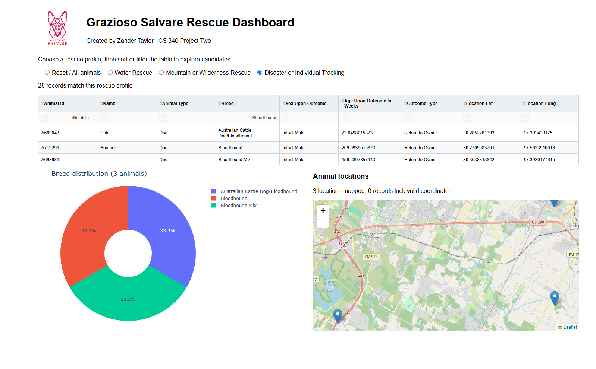

# Grazioso Salvare Dashboard README

Author: Zander Taylor

## Project overview

This dashboard helps Grazioso Salvare explore animal shelter outcomes and identify dogs that match rescue training profiles. MongoDB provides the model, Dash widgets provide the view, and Python callbacks query the Project One CRUD module and coordinate the table and charts. The dataset records historical outcomes; a matching profile does not establish current adoption availability.

## Functionality

The initial view retrieves all records with read({}). Radio controls query Water Rescue, Mountain or Wilderness Rescue, Disaster or Individual Tracking, or Reset. The table supports ten rows per page, multiple column sorting, and column filters. The breed distribution and clustered location map follow all table matches across pages. Reset clears column filters and sorting, returns to the first page, and retrieves all database records. The logo links to https://www.snhu.edu. The dashboard credits Zander Taylor as its creator.

## Rescue query rules

Water: Labrador Retriever Mix, Chesapeake Bay Retriever, Newfoundland; Intact Female; 26 through 156 weeks. Mountain or Wilderness: German Shepherd, Alaskan Malamute, Old English Sheepdog, Siberian Husky, Rottweiler; Intact Male; 26 through 156 weeks. Disaster or Individual Tracking: Doberman Pinscher, German Shepherd, Golden Retriever, Bloodhound, Rottweiler; Intact Male; 20 through 300 weeks. All profiles require animal_type Dog. Age bounds are inclusive and follow the specification table. Breed matching accepts named breed components and mixes, including slash-separated crosses; Water Labrador specifically requires the Mix suffix. This matching interpretation is documented so another organization can adjust it.

## Tools and rationale

MongoDB stores flexible animal records as documents and supports compound queries, regular expressions, projections, and numeric range comparisons. PyMongo maps Python dictionaries to queries and returns documents that pandas can prepare for the dashboard. Dash provides HTML components, controls, a data table, and reactive callbacks in Python. Plotly provides the interactive breed chart; Dash Leaflet provides the location map and clustering. Jupyter keeps the required dashboard source in an executable notebook. Modern Dash includes notebook support, replacing the older JupyterDash dependency.

## Reproduction instructions

1. Extract the code ZIP into one folder in Codio. Keep CRUD_Python_Module.py, rescue_queries.py, ProjectTwoDashboard.ipynb, and the logo together. The tested Codio environment uses Python 3.11.2.
2. In the Codio terminal, run cd /home/codio/workspace/Project_Two, then python -m pip install -r requirements.txt. Keep only dash, dash-leaflet, pandas, plotly, and pymongo in requirements.txt; leave Codio notebook software at its supplied versions.
3. Confirm MongoDB is running and aac.animals contains the AAC dataset from Project One. If importing into a fresh database, use: mongoimport --db aac --collection animals --type csv --headerline --file aac_shelter_outcomes.csv. Add authentication options as required by your configured server. Do not reimport into an existing populated collection. Confirm age_upon_outcome_in_weeks, location_lat, and location_long are numeric.
4. Open the notebook. Set CREATOR_NAME to "Zander Taylor" and password to the working aacuser password in the private course notebook. The notebook explicitly instantiates AnimalShelter with the credentials as required by the assignment. Use db = AnimalShelter(username, password, auth_source="admin") for the tested Codio account. Authentication against aac failed; admin succeeded. The queried data remains in aac.animals.
5. Open ProjectTwoDashboard.ipynb in JupyterLab from Project_Two. Run the configuration cell and print(initial_status) to verify the database count. Run the layout cell, controller cell, and final app.run cell in order. The tested startup is app.run(host="0.0.0.0", port=8050, debug=False, jupyter_mode="external"). Open http://supertwin-dolphinclone-8050.codio.io/ while this workspace is running. For another Codio box, substitute its box name. The displayed 0.0.0.0 address is a binding address and cannot be used directly from the local browser. Map tiles require internet access.
6. Exercise every rescue filter, sorting, pagination, a column filter, and Reset. Test an empty column-filter result. Check the map and breed chart change with the table and that Reset restores the original count.
7. Save the tested notebook with Ctrl + S and download it from Codio for the code ZIP. Include the updated CRUD module, rescue_queries.py, logo, requirements.txt, and documentation. Clear notebook outputs and remove the real password before publishing a public copy on GitHub. Keep credentials in the private course environment. GitHub publication remains a separate step; no repository URL is available.

## Implementation and challenges

The supplied Project One create, update, and delete routines are preserved. Initialization now accepts credentials and authentication settings. The read routine accepts an optional projection and propagates connection failures so the controller can display an explicit error. Projection excludes MongoDB ObjectId values before JSON serialization. Numeric coercion and null handling protect chart rendering. Charts use derived_virtual_data so table filters apply across pages. GeoJSON clustering supports large initial result sets. The breed chart groups records beyond the ten most frequent breeds into Other breeds while preserving the total. Empty result sets clear the map and display a chart message. During Codio setup, rescue_queries.py was missing and caused ModuleNotFoundError; placing it beside the notebook fixed the import. MongoDB authentication failed with auth_source="aac" and succeeded with "admin". Installing notebook 7 upgraded Jupyter beyond nbgrader compatibility; restoring notebook 6.5.4, jupyter-server 1.24.0, jupyterlab 3.6.3, and jupyterlab-server 2.22.1 resolved the reported dependency conflicts. python -m pip check then reported no broken requirements. Removing the notebook entry from requirements.txt prevents that upgrade on future installs. The application was reached through the Codio port URL after the local 0.0.0.0 link failed.

## Validation results

The dashboard was run in Codio against MongoDB. Initial loading and Reset returned 10,001 records, and 10,000 valid locations were mapped. One record lacked valid coordinates. The supplied CSV has 10,000 records; the additional database record was not conclusively identified during testing.

Water Rescue returned 17 animals and 17 valid locations. Mountain or Wilderness Rescue returned 19 animals and 19 valid locations. Disaster or Individual Tracking returned 28 animals and 28 valid locations. The corresponding charts and table updated in each supplied screenshot. The visible rows satisfy the applicable sex and age criteria. Local CSV query checks had independently produced the same rescue counts.

A Breed column filter for Bloodhound narrowed the Disaster results to three records. The breed chart and map also displayed three animals. The rescue status continued to show 28 because it describes the database profile result before additional table filtering. Reset cleared the Bloodhound filter, returned the table to page 1, and restored the original chart and map totals. Screenshots show pagination controls; an explicit page-change test and an empty-result test were not recorded. The logo link is implemented in the source; a separate click-test result was not recorded.

## Dashboard execution evidence

The following screenshots capture the initial view, all three rescue filters, and Reset. Each image contains the Grazioso Salvare logo, the creator name, rescue controls, table, breed chart, and location map. The additional Bloodhound screenshot documents linked updates after table filtering.

### Figure 1 Initial dashboard

Initial loading shows 10,001 animals and 10,000 valid locations.

### Figure 2 Water Rescue

The profile returns 17 animals; the breed chart and location map update to 17.

### Figure 3 Mountain or Wilderness Rescue

The profile returns 19 animals and 19 valid locations.

### Figure 4 Disaster or Individual Tracking

The profile returns 28 animals and 28 valid locations.

### Figure 5 Reset after table filtering

Reset restores 10,001 animals, clears the column filter, returns to page 1, and maps 10,000 locations.

### Figure 6 Additional table filter test

Filtering Breed to Bloodhound narrows the table, chart, and map to three animals.

## Resources

Assignment source: CS 340 Dashboard Specifications Document, supplied course PDF.
MongoDB documentation: https://www.mongodb.com/docs/manual/
PyMongo documentation: https://www.mongodb.com/docs/languages/python/pymongo-driver/current/
Dash notebook support: https://dash.plotly.com/dash-in-jupyter
Dash table reference: https://dash.plotly.com/datatable
Dash callbacks: https://dash.plotly.com/basic-callbacks
Dash Leaflet: https://www.dash-leaflet.com/
Plotly Python: https://plotly.com/python/
pandas: https://pandas.pydata.org/docs/
OpenStreetMap: https://www.openstreetmap.org/copyright
GitHub publication: https://github.com/Zykopath/grazioso-salvare-dashboard
